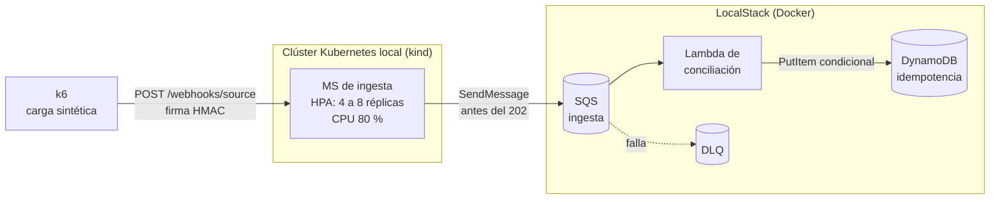

# poc-asr1 · Prueba de concepto del ASR1 (ingesta de webhooks)

Prueba de concepto del **ASR1** del proyecto del curso **ARTI4207 Architecting for the Cloud** (MATI, Universidad de los Andes, grupo 2, «The Money App»).

> **Uso académico exclusivo / Academic use only.** Este repositorio es un trabajo universitario. Usa datos sintéticos y nombres genéricos.
> No contiene datos, esquemas, credenciales ni identificadores de ninguna empresa o cliente.

## 1. Qué se prueba

**Hipótesis (ASR1).** Un microservicio de ingesta *sin estado* que guarda cada webhook en una cola **antes** de responder `202` puede escalar horizontalmente
durante el pico de nómina (de 125 a 500 webhooks por segundo en 1 minuto, sostenido 5 minutos) cumpliendo:

| Criterio | Meta |
|---|---|
| Latencia p99 de la ingesta a 500 req/s | < 300 ms |
| Errores (incluido el momento del escalado) | < 0,1 % |
| Réplicas nuevas atendiendo tráfico | ≤ 3 min |
| Webhooks perdidos (`202` que no llegan a la cola) | 0 |



El entorno local replica la **forma** de lo observado en un servicio comparable de producción (HPA mín 4 / máx 8, CPU 80 % del *request*, Java 25, límite de CPU 2000m).
Los valores absolutos (p99, tiempo de escalado) en un portátil son **indicativos**, no comparables con producción: ver [`docs/as-is-to-be-configuracion.md`](docs/as-is-to-be-configuracion.md).

## 2. Requisitos

Probado en macOS (Apple Silicon). En Linux debería funcionar igual; en Windows, usar WSL2 (no probado).

| Herramienta | Para qué | Versión probada | Instalar (macOS) |
|---|---|---|---|
| Docker Desktop | contenedores, kind, LocalStack | 29 | `brew install --cask docker` |
| kind | clúster Kubernetes local | 0.32 | `brew install kind` |
| kubectl | operar el clúster | 1.36 | `brew install kubectl` |
| Helm | desplegar el MS | 4.2 | `brew install helm` |
| Terraform | crear SQS, DynamoDB y Lambda en LocalStack | 1.15 | `brew install terraform` |
| k6 | carga desde tu equipo (opcional si usas el generador en el clúster) | 2.1 | `brew install k6` |
| AWS CLI v2 | hablar con LocalStack | 2.13 | `brew install awscli` |
| Python 3 | scripts de apoyo y dashboard | 3.11+ | `brew install python` |
| curl, openssl, jq | pruebas manuales | cualquiera | ya vienen o `brew install jq` |

**No necesitas** Java ni Maven: el microservicio se compila dentro de Docker (Maven + Java 25).

**Recursos.** En Docker Desktop → *Settings → Resources*: **memoria ≥ 16 GiB** (validado) y **8 CPUs o más** (recomendado; las pruebas se hicieron con 14). Con menos, los pods de 8 réplicas no caben y las pruebas de carga no son confiables.
Espacio en disco: ~8 GB (imágenes).

## 3. Paso a paso

### Paso 1 · Clonar y activar el control anti-fugas
```bash
git clone https://github.com/kevjo95/poc-asr1.git
cd poc-asr1
git config core.hooksPath .githooks      # bloquea credenciales y ARNs si haces commits
```

### Paso 2 · Preparar Python (una sola vez)
```bash
python3 -m venv .venv
.venv/bin/pip install boto3
export PY="$PWD/.venv/bin/python"        # lo usan los scripts de carga; repítelo en cada terminal nueva
```

### Paso 3 · Levantar todo el entorno
```bash
./scripts/cluster-up.sh
```
Hace, en orden: LocalStack → Terraform (SQS, DLQ, DynamoDB, Lambda) → compila la imagen del MS → crea el clúster kind (1 plano de control + 3 workers)
→ instala metrics-server → despliega el MS con Helm (HPA 4–8). **La primera vez tarda ~10 min** (descarga imágenes y compila); las siguientes, ~2 min.

Termina con `Listo. MS en http://localhost:8080`. Para usar `kubectl` en tu terminal sin tocar tu `~/.kube/config`:
```bash
export KUBECONFIG="$HOME/.kube/poc-asr1.yaml"
```

### Paso 4 · Verificar que está vivo
```bash
curl -s localhost:8080/actuator/health        # {"status":"UP",...}
kubectl get pods,hpa                           # 4 pods Running y el HPA ingest-ms (4/8)
```

### Paso 5 · Pruebas funcionales (≈ 5 min en total)
Cada una deja su evidencia en `results/summaries/`.

| Comando | Qué comprueba | Resultado esperado |
|---|---|---|
| `./scripts/f2-idempotencia.sh` | La Lambda descarta duplicados | 50 únicos + 10 duplicados → 50 `COMPLETADO` |
| `./scripts/f3-contrato.sh` | Contrato del MS (`202/400/401/404/503`) | 9 de 9 casos |
| `./scripts/f4-cero-perdidos.sh` | Cada `202` termina en la cola y se procesa | 0 perdidos |
| `./scripts/send-one.sh` | Envía un webhook firmado a mano | `HTTP 202` |

Guía manual con `curl`: [`docs/manual-testing.md`](docs/manual-testing.md). Con Postman: importa `postman/poc-asr1.postman_collection.json` y
`postman/local.postman_environment.json` ([instrucciones](postman/README.md)); la firma HMAC se calcula sola.

### Paso 6 · Abrir el monitoreo en vivo (recomendado, sobre todo para grabar)
En **otra terminal**:
```bash
./scripts/dashboard.sh                         # abre http://localhost:8765
```
Muestra el flujo completo (k6 → MS → SQS → Lambda → DynamoDB), p99, errores, réplicas, CPU del HPA, cola, DLQ, detalle por pod y el escenario en curso.
Detalle en [`docs/monitoring.md`](docs/monitoring.md).

### Paso 7 · Ejecutar las pruebas de carga
Cada escenario prepara el clúster, hace un pre-calentamiento, mide, concilia y genera un informe. Recomendado: generador de carga **dentro del clúster**
(`LOADGEN=incluster`), porque k6 en tu equipo compite por CPU con el propio clúster y distorsiona la latencia.

```bash
export LOADGEN=incluster
./scripts/run-scenario.sh p0     # calibración: 1 réplica fija, sube de 50 en 50 req/s       (~15 min)
./scripts/run-scenario.sh p1     # base: 125 req/s con HPA                                    (~35 min; acorta con DURATION_S=300)
./scripts/run-scenario.sh p2     # ASR1: ráfaga 125 → 500 req/s, 5 min sostenido              (~20 min)
./scripts/run-scenario.sh p3     # estrés: desde 500 req/s, +100 cada 2 min hasta quebrar     (~25 min)
```
- **No ejecutes dos escenarios a la vez** ni uses el equipo para otra tarea pesada mientras corren.
- Mientras corre un escenario se **pausa la Lambda** a propósito (en LocalStack compite por CPU con SQS y contamina la latencia); se reanuda al final.
- Parámetros útiles: `DURATION_S`, `BASE_RATE` (P1), `WARMUP_S`, `HOLD_S` (P2), `STEPS`, `STEP`, `START_RATE`, `STEP_S` (P0/P3), `DRAIN_TIMEOUT_S`.

**Dónde queda el resultado**

| Archivo | Contenido |
|---|---|
| `results/summaries/<corrida>-informe.md` | Informe legible: p95/p99 y errores por fase, réplicas, CPU, tiempo de escalado, arranque de pods, conciliación |
| `results/summaries/<corrida>.json` | Resumen crudo de k6 |
| `results/summaries/<corrida>-reconcile.txt` | Conciliación: `202` contados contra mensajes en SQS |
| `results/raw/<corrida>/` | Datos crudos (réplicas, CPU, eventos, pods). No se versiona |

**Cómo leer el informe.** Mira primero que `dropped_iterations` sea 0 (si no, el generador es el cuello de botella y la medición no vale). Después las tablas por fase y,
para P2, los veredictos del ASR1. Los hallazgos de cada escenario están en [`docs/scenarios/`](docs/scenarios/README.md).

### Paso 8 · Capturar evidencia para un video (opcional)
Mientras corre un escenario, en otra terminal: `./scripts/capture-evidence.sh p2` guarda una captura del dashboard cada 30 s en `results/evidence/p2/`.

### Paso 9 · Apagar y limpiar
```bash
./scripts/cluster-down.sh        # borra el clúster, LocalStack y su estado
```

## 4. Estructura del repositorio

| Ruta | Contenido |
|---|---|
| `services/ingest-ms/` | MS de ingesta (Spring Boot, Java 25): valida firma, guarda en SQS y responde `202` |
| `services/reconciler-lambda/` | Lambda de conciliación e idempotencia (Python) con sus tests |
| `infra/modules`, `infra/envs/local` | Terraform: cola, DLQ, tabla de idempotencia y Lambda sobre LocalStack |
| `infra/envs/aws` | Mismo Terraform para una cuenta AWS propia (solo `validate`; no se ha aplicado) |
| `infra/cluster`, `infra/local` | Configuración de kind y de LocalStack |
| `deploy/helm/ingest-ms/` | Chart de Helm con el HPA de producción (mín 4, máx 8, CPU 80 %) |
| `load/` | Escenarios de k6: `p0` calibración, `p1` base, `p2` ráfaga, `p3` estrés, `prewarm` |
| `scripts/` | Orquestación (`cluster-up`, `run-scenario`, análisis), pruebas funcionales, dashboard |
| `postman/` | Colección y entorno de Postman |
| `docs/` | ADR (decisiones), escenarios con evidencia, spike, registro de cambios para el documento de la clase |

## 5. Documentación

- [`PoC-ingesta-webhooks.md`](PoC-ingesta-webhooks.md): definición original de la PoC (hipótesis, escenarios, criterios).
- [`docs/scenarios/README.md`](docs/scenarios/README.md): fichas y resultados de cada escenario.
- [`docs/as-is-to-be-configuracion.md`](docs/as-is-to-be-configuracion.md): configuración observada en producción frente a la que necesita este MS.
- [`docs/adr/`](docs/adr): decisiones de arquitectura (entorno, Java 25, perfil de recursos, etc.).
- [`docs/cambios-al-documento.md`](docs/cambios-al-documento.md): qué debe ajustarse en el documento del proyecto según lo medido.
- [`docs/spike-01-referencia-productiva.md`](docs/spike-01-referencia-productiva.md): línea base observada en un servicio comparable.

## 6. Problemas frecuentes

| Síntoma | Causa y solución |
|---|---|
| Un pod queda en `ImagePullBackOff` | La imagen no está cargada en kind. Vuelve a ejecutar `./scripts/cluster-up.sh` |
| `Bind for 127.0.0.1:8080 failed` o `address already in use` | Otro programa usa el puerto 8080 (o 4566/8765). Ciérralo o cambia el puerto (`PORT=8766 ./scripts/dashboard.sh`) |
| Pods `Pending` o el HPA no pasa de 4 réplicas | Docker Desktop sin memoria/CPU suficientes. Sube a ≥ 16 GiB y 8 CPUs o más, y reinicia Docker |
| `ModuleNotFoundError: boto3` | Falta el paso 2 o `PY` no está exportado en esta terminal |
| `kubectl` apunta a otro clúster | `export KUBECONFIG="$HOME/.kube/poc-asr1.yaml"` en esa terminal |
| El informe dice `dropped_iterations` > 0 | El generador no sostuvo la tasa. Usa `LOADGEN=incluster`, cierra otras aplicaciones y repite |
| El p99 sube sin motivo | Había otra tarea pesada en el equipo o la Lambda estaba activa. Repite con el equipo en reposo |
| `terraform apply` falla al iniciar | LocalStack aún no estaba listo: espera 20 s y repite `./scripts/cluster-up.sh` |
| Quieres empezar de cero | `./scripts/cluster-down.sh` y luego `./scripts/cluster-up.sh` |

## 7. Ejecución en una cuenta AWS propia (opcional)

La PoC se ejecutó también en AWS (EKS + SQS + Lambda + DynamoDB reales): resultados en `docs/scenarios/P2-aws.md` y `docs/scenarios/P3-aws.md`, plan en `docs/plans/0002-validacion-en-aws.md`.
Cuesta dinero (unos 0,3–0,5 USD por hora con todo encendido) y **se debe destruir al terminar**.

1. Prepara la cuenta y el perfil de CLI: `docs/aws-cuenta-personal.md`. Define un presupuesto antes de crear nada y usa siempre un perfil propio (`AWS_PROFILE`). Nunca un perfil de trabajo.
2. `cp infra/envs/aws-eks/terraform.tfvars.example infra/envs/aws-eks/terraform.tfvars`, elige un preset (cuota de 5 vCPU o completo) y revisa `terraform plan`.
3. `terraform -chdir=infra/envs/aws-eks apply` (pide confirmación). Crea red, EKS, ECR, cola, DLQ, tabla, Lambda, roles y un panel de CloudWatch.
4. `INGEST_HMAC_SECRET=$(openssl rand -hex 16)` y `./scripts/aws-up.sh` (sube la imagen y despliega el MS). Guarda ese secreto solo en tu consola.
5. En otra terminal: `TARGET=aws ./scripts/dashboard.sh`. Luego `TARGET=aws ./scripts/run-scenario.sh p2` o `p3` (ver el guion en `docs/guion-video-aws.md`).
6. **Al terminar:** `./scripts/aws-down.sh` y comprueba que no queden recursos. Revisa Cost Explorer al día siguiente.

No se versionan credenciales, secretos ni identificadores de cuenta.

## 8. Controles de seguridad del repositorio

- Hook de pre-commit (`.githooks/pre-commit`) que bloquea cadenas parecidas a credenciales, ARNs e identificadores de cuenta. Se activa con `git config core.hooksPath .githooks`.
- Opcionalmente, una lista local `blocklist.txt` (ignorada por Git) con términos que nunca deben aparecer en el repositorio.
- El secreto HMAC de las pruebas (`poc-local-secret`) es sintético y solo existe en el entorno local.
